# Godown: inventory and purchase management

Godown is a stock and purchasing system for a small shop. It tracks products and suppliers, records every receipt and issue, **refuses any issue that would take stock below zero**, keeps a permanent transaction history, and shows low-stock alerts on a dashboard.

The demo data is a Hyderabad grocery and household shop: 37 products, 6 suppliers, 6 categories and 45 days of stock history.

| | |
|---|---|
| **Live app** | https://godown-gamma.vercel.app/#/login |
| **Source** | https://github.com/sathvik1518/Godown |
| **Admin login** | `saisathvik@gmail.com` / `Admin@123` |
| **Staff login** | `kavya.reddy@gmail.com` / `Staff@1234` |
| **API docs** | https://godown-gamma.vercel.app/api/docs |

The login screen has "Admin demo" and "Staff demo" buttons that fill these in. Change the demo passwords before putting real data in.

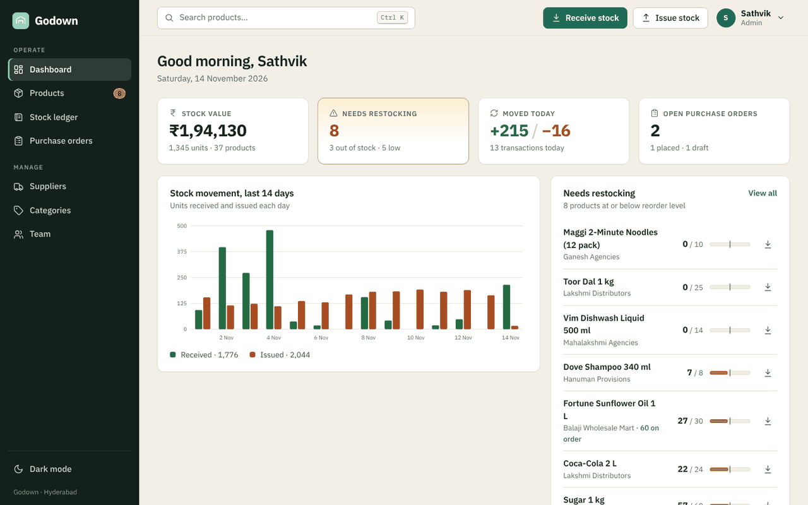

## Contents

1. [What it does](#what-it-does)
2. [Screenshots](#screenshots)
3. [Roles](#roles)
4. [How stock stays correct](#how-stock-stays-correct)
5. [Database design](#database-design)
6. [API](#api)
7. [Validation and error handling](#validation-and-error-handling)
8. [Security](#security)
9. [Frontend](#frontend)
10. [Run it on your computer](#run-it-on-your-computer)
11. [Tests](#tests)
12. [Deploy to Vercel with Neon](#deploy-to-vercel-with-neon)
13. [Project layout](#project-layout)
14. [Design decisions](#design-decisions)
15. [Troubleshooting](#troubleshooting)
16. [Known limits and next steps](#known-limits-and-next-steps)

## What it does

- **Products**: SKU, category, supplier, unit, cost and selling price, reorder level, shelf location. Search by name or SKU, filter by category, supplier or stock status (in stock, low, out, needs restocking, archived), sort, page, export to CSV. A product with history is archived, never deleted.
- **Receive, issue, adjust**: one dialog for each. Issue is refused when it would take stock below zero, and the dialog shows the balance you will end up with before you submit. Adjust is for stock counts and needs a note.
- **Stock ledger**: every movement with who, when, why (sale, damage, return and so on), a bill or reference number, and the balance after. Filter by product, type, date range or text. Export to CSV. It cannot be edited or deleted.
- **Purchase orders**: draft, place, receive, cancel. Staff raise drafts, an admin approves (places) them, and anyone can receive the goods. Receiving a placed order adds every line to stock in one transaction, or none of it. A draft can be edited until it is placed. Orders print cleanly.
- **Draft purchase orders from low stock**: one click on the dashboard builds one draft per supplier from everything at or below its reorder level, sized to bring stock back to twice the reorder level. Products already on an open order, or with no supplier, are skipped.
- **Dashboard**: stock value, low and out-of-stock counts, units moved today, a 14-day received-versus-issued chart, a restock list with one-click receive, value by category, open orders, recent activity.
- **Product page**: on-hand quantity, 30-day issue rate, days of cover, quantity on order, margin, a stock-level chart over the last 40 movements with the reorder line, and the product's own ledger.
- **Suppliers, categories, team**: admins manage them. Suppliers store GSTIN (validated), phone and email.
- **Also**: Ctrl+K quick find from any page, dark mode, phone layout with bottom navigation, login lockout, change password.

## Screenshots

| | |
|---|---|
| 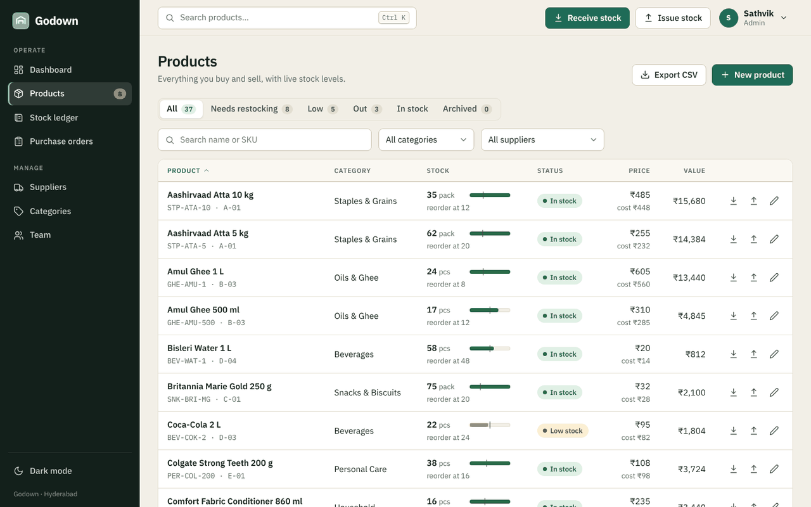 **Products**: filters, stock gauges, one-click receive and issue | 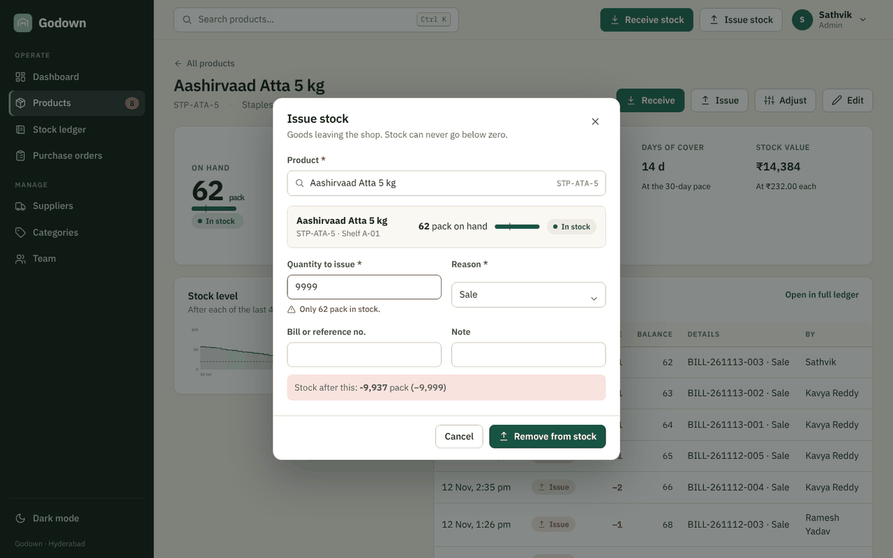 **Negative stock blocked**: the shortfall is shown before you submit |
| 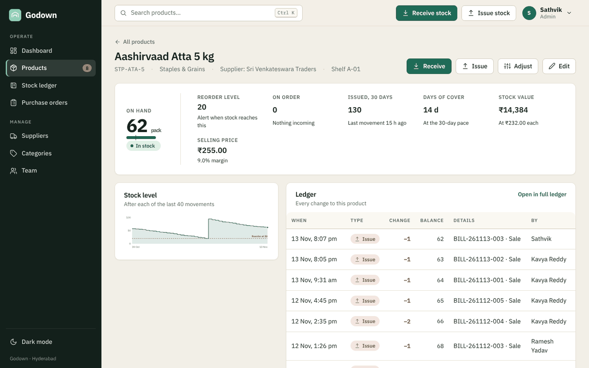 **Product page**: cover days, stock-level chart, own ledger | 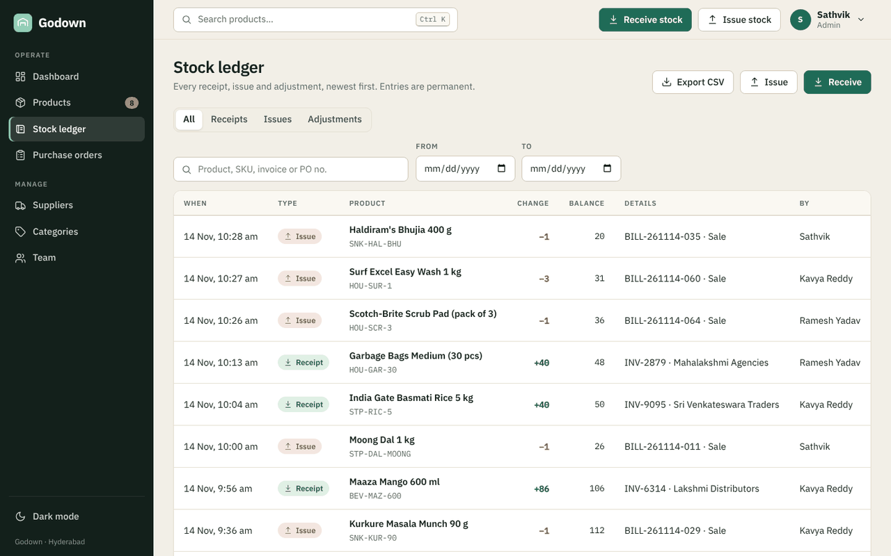 **Stock ledger**: filterable, exportable, append-only |
| 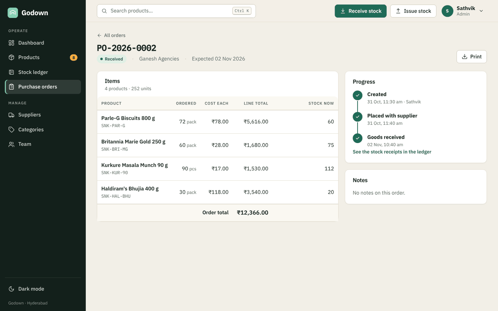 **Purchase order**: progress timeline, print | 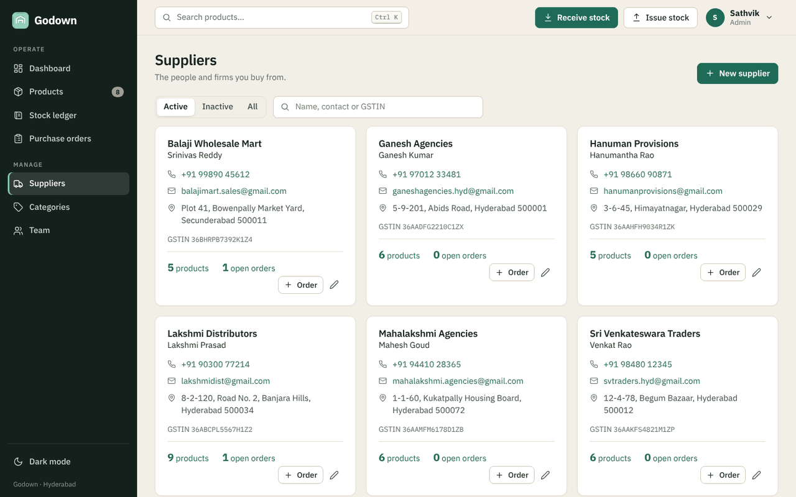 **Suppliers** |
| 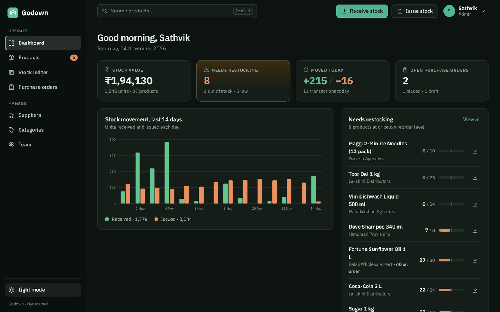 **Dark mode** | 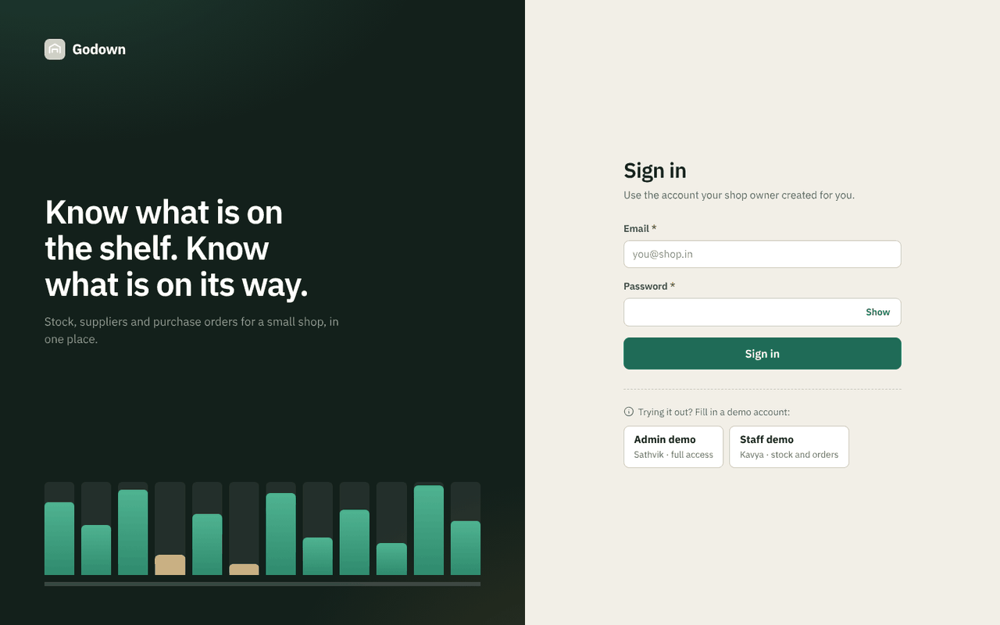 **Sign in** |

On a phone the tables become cards and navigation moves to a bottom bar:

<p>
  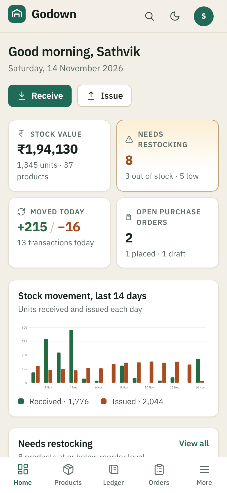
  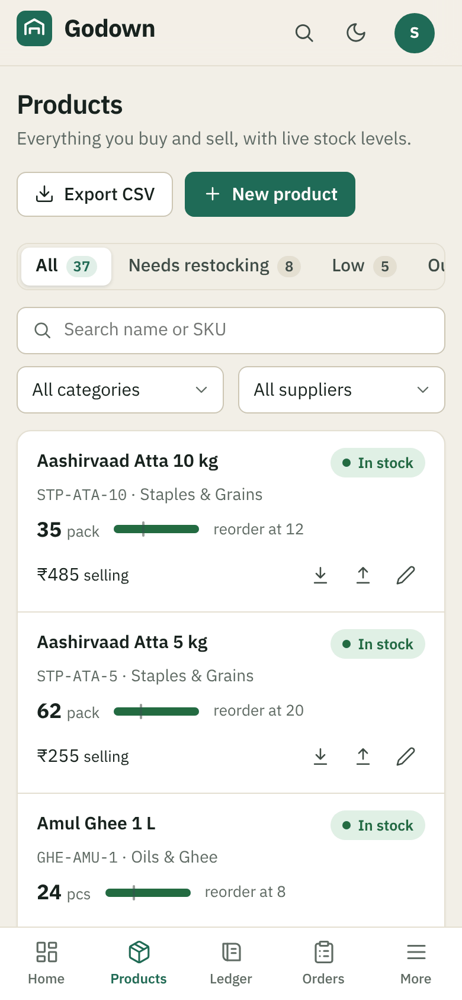
</p>

## Roles

| Action | Staff | Admin |
|---|:-:|:-:|
| View dashboard, products, ledger, suppliers, orders | yes | yes |
| Receive and issue stock | yes | yes |
| Create and edit draft purchase orders, receive placed ones | yes | yes |
| Adjust stock (counts, write-offs) | no | yes |
| Add, edit, archive products | no | yes |
| Add, edit suppliers and categories | no | yes |
| Place (approve) and cancel purchase orders, manage team accounts | no | yes |

The server enforces this on every route. The interface also hides what a role cannot use, but hiding is only a courtesy. Deactivating a user takes effect immediately, because the account is checked on every request.

## How stock stays correct

Every change to stock goes through one function, `post_movement()` in `backend/services/stock.py`. In one database transaction it:

1. locks the product row (`SELECT ... FOR UPDATE`),
2. checks that an issue does not exceed the quantity on hand,
3. updates `products.qty_on_hand`,
4. writes a ledger row with the signed quantity and the balance after.

Consequences:

- Two people issuing the last unit at the same moment: one succeeds, the other gets a clear "only N in stock" error. There is a test for this.
- A failure anywhere rolls the whole change back. There is never a ledger row without a stock change, or the reverse.
- Receiving a purchase order posts all its lines inside one transaction. If any line fails, nothing is received and the order stays placed.
- Even if a future bug skipped the check, the database refuses it: `CHECK (qty_on_hand >= 0)`.

## Database design

Seven tables in third normal form. Migrations are plain SQL files in `backend/migrations`, applied in order and recorded in a table, under an advisory lock so two servers starting together cannot migrate at once.

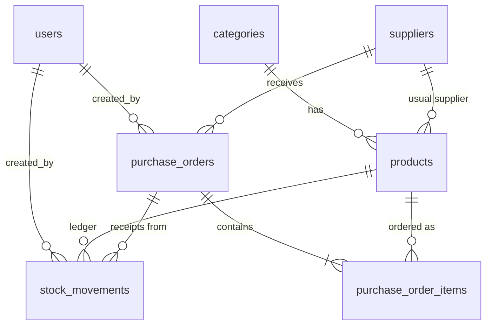

| Table | Holds | Key rules |
|---|---|---|
| `users` | name, email, bcrypt hash, role, active flag | role is `admin` or `staff`; email unique ignoring case |
| `categories` | name, description | name unique ignoring case |
| `suppliers` | name, contact, phone, email, address, GSTIN, active flag | GSTIN must match the Indian GSTIN pattern; name unique ignoring case |
| `products` | SKU, name, category, supplier, unit, cost, price, reorder level, `qty_on_hand`, location, active flag | `qty_on_hand >= 0`; prices and reorder level `>= 0`; SKU unique ignoring case; indexed by category, supplier and name |
| `stock_movements` | product, type, signed quantity, balance after, unit cost, supplier, reference, reason, note, user, time, purchase order | the ledger; see below |
| `purchase_orders` | PO number, supplier, status, dates, notes, user | status is `draft`, `ordered`, `received` or `cancelled`; PO number from a sequence, like `PO-2026-0003` |
| `purchase_order_items` | order, product, quantity, unit cost | quantity `> 0`; one line per product per order |

The ledger, `stock_movements`, is protected at the database level:

- the sign of `quantity` must match the type: receipts positive, issues negative, adjustments either,
- `quantity` is never zero and `balance_after` is never negative,
- a trigger raises an error on any `UPDATE` or `DELETE`, so history cannot be rewritten,
- foreign keys are `ON DELETE RESTRICT`, so a product or supplier with history cannot be removed. The app archives them instead.

## API

All routes are under `/api`, JSON in and out. Interactive docs (Swagger) are at `/api/docs`.

| Area | Routes |
|---|---|
| Auth | `POST /auth/login`, `GET /auth/me`, `POST /auth/change-password` |
| Products | `GET /products` (q, category_id, supplier_id, status, sort, order, page, page_size), `GET /products/summary`, `GET /products/export.csv`, `GET /products/{id}`, `POST /products`, `PATCH /products/{id}`, `DELETE /products/{id}` |
| Stock | `POST /stock/receipts`, `POST /stock/issues`, `POST /stock/adjustments` (admin), `GET /movements` (product_id, type, date_from, date_to, q), `GET /movements/export.csv` |
| Purchase orders | `GET /purchase-orders`, `POST /purchase-orders`, `GET /purchase-orders/{id}`, `PUT /purchase-orders/{id}` (drafts only), `POST .../order` (admin), `POST .../receive`, `POST .../cancel` (admin), `POST /purchase-orders/from-low-stock` |
| Suppliers | `GET/POST /suppliers`, `GET/PUT/DELETE /suppliers/{id}` |
| Categories | `GET/POST /categories`, `PUT/DELETE /categories/{id}` |
| Users | `GET/POST /users`, `PATCH /users/{id}` (admin) |
| Dashboard | `GET /dashboard` |
| Health | `GET /api/health` |

Lists are paged as `{ "items": [...], "total": 37, "page": 1, "page_size": 25, "pages": 2 }`.

Example, issuing more than is on hand:

```http
POST /api/stock/issues
{ "product_id": 2, "quantity": 9999, "reason": "sale" }

409 Conflict
{
  "detail": "Only 62 of Aashirvaad Atta 5 kg in stock. You cannot issue 9999.",
  "code": "insufficient_stock"
}
```

## Validation and error handling

- Every error has the same shape: `{ "detail": "...", "code": "...", "errors": { "field": "message" } }`. The `errors` map points at the form field to highlight.
- Request bodies are validated with Pydantic: types, lengths, ranges, formats (email, SKU characters, GSTIN, phone).
- Business rules are checked in the service layer: no negative stock, no editing a placed order, no receiving an order that is not placed, no deleting a product or supplier that has history (archive instead).
- The interface repeats the same rules before sending, so people see the message beside the field and the server's answer is a backstop. A server-side field error is placed on the same field.
- Database failures never leak internals: a unique-constraint clash becomes "This SKU is already used by another product." on the SKU field, and a connection failure becomes a plain 503 message.
- Lists show skeleton loaders, empty states with a next step, and an error state with a retry button.

## Security

- Passwords are hashed with bcrypt. Tokens are signed JWTs (HS256) that expire after 8 hours.
- After 5 wrong passwords for one email within 5 minutes, login returns 429 for a while.
- The signing key comes from `JWT_SECRET`. On Vercel the app refuses to start without it.
- All SQL uses bound parameters. Nothing is built by string concatenation.
- CSV exports neutralise cells that start with `=`, `+`, `-` or `@`, so a product named `=HYPERLINK(...)` cannot run as a spreadsheet formula.
- The test suite refuses to run when `DATABASE_URL` is set, so tests can never touch a real database.
- Staff cannot reach admin routes even by calling the API directly.

## Frontend

React 18 and Vite, no UI kit and no chart library. The design system is in `frontend/src/styles`: warm paper background, deep green brand, IBM Plex Sans and Mono, one set of colour tokens for light and dark.

- Hash routing (`/#/products`), so a refresh works on any page with no server rewrite.
- Filters live in the URL, so a filtered list can be bookmarked or shared.
- Dialogs trap focus, close on Esc and restore focus. Every form field has a label, a hint and an error wired together for screen readers. A skip link, visible focus rings and reduced-motion support are in the base styles.
- Tables turn into cards under 760 px. Charts are hand-written SVG with hover details.
- The whole bundle is about 86 KB gzipped.

## Run it on your computer

You need Python 3.11+, Node 18+ and PostgreSQL. Settings are read from environment variables (`.env.example` lists them all). Defaults point at a local Postgres user `postgres` and database `godown_dev`.

```powershell
# 1. Database
createdb -U postgres godown_dev
createdb -U postgres godown_test

# 2. Backend
cd backend
python -m venv venv
venv\Scripts\activate
pip install -r requirements-dev.txt
$env:DB_PASSWORD = "your-postgres-password"
python seed.py --reset             # loads the demo data (type YES, in capitals, when asked)
uvicorn main:app --reload --port 8000

# 3. Frontend, in a second terminal
cd frontend
npm install
npm run dev                        # opens http://localhost:5173
```

The environment variable lasts only for that terminal window. Set it again in any new one.

## Tests

```powershell
cd backend
$env:DB_PASSWORD = "your-postgres-password"
pytest -q                          # 113 tests, uses the godown_test database

cd ..\frontend
npm test                           # 37 tests
```

Backend tests run against a real PostgreSQL database, not mocks. They cover:

- the negative-stock rule and two simultaneous issues of the last unit,
- receive, issue and adjust, and the balance after each,
- the append-only ledger (updates and deletes are rejected),
- purchase orders: every status change, all-or-nothing receiving, drafts from low stock,
- roles on every route, login, lockout and password change,
- validation messages, error format, CSV export and formula neutralising,
- seed data and the dashboard figures.

Frontend tests cover the formatting helpers, every form validator (stock, product, supplier, order), the stock pills and gauge, pagination, the login screen (errors, demo buttons), role-based menus and the dashboard with a mocked API.

## Deploy to Vercel with Neon

1. Create a Neon project and copy the connection string. It must start with `postgresql://` and has no quotes around it.
2. Push this repo to GitHub.
3. In Vercel choose **Add New, Project**, import the repo, and set **Framework Preset** to **Other**. Leave the root as the repo root; `vercel.json` already sets the build command and output folder. Ignore the "possible configuration mismatch" note.
4. Add two environment variables: `DATABASE_URL` (the Neon string) and `JWT_SECRET` (any long random text, 40 or more characters).
5. Deploy. The first request creates the tables and loads the demo data, so it takes a few seconds longer.
6. Open `https://YOUR-PROJECT.vercel.app/#/login` and sign in as the admin.

To start with an empty shop instead of demo data, set `SEED_DEMO=0` before the first request. The admin account is still created. `ADMIN_EMAIL` and `ADMIN_PASSWORD` change the first admin's login.

## Project layout

```
api/index.py            Vercel entry point, mounts the backend under /api
vercel.json             build command, output folder, /api rewrite
backend/
  main.py               FastAPI app, CORS, error handlers
  config.py db.py       settings, connection and transaction helper
  migrate.py            SQL migration runner
  migrations/           001 core schema, 002 purchase orders, 003 append-only ledger
  routers/              one file per area (auth, products, stock, purchase_orders, ...)
  services/stock.py     post_movement(): the only way stock changes
  seed.py               demo data
  tests/                113 tests
frontend/src/
  api.js                every API call, one place
  pages/                one file per screen
  components/           dialogs, forms, charts, layout, stock picker
  context/              auth, toasts, refresh, stock dialogs
  styles/               tokens, base, layout, components, pages
  test/                 37 tests
docs/screenshots/       images used in this README
```

## Design decisions

- **Signed ledger with balance after each row.** Any product's history can be audited without recomputing, and a wrong balance would show up as a break in the chain.
- **Archive, never delete.** Products and suppliers with history are marked inactive, so old ledger rows and orders always make sense.
- **Cost recorded per receipt.** Stock value uses the current cost, while history keeps what was actually paid.
- **Plain SQL, no ORM.** The locking and constraints are the point of the project, and they are easier to read and check as SQL.
- **Receive is all-or-nothing.** A half-received order is harder to explain and fix than one that failed cleanly.
- **One Vercel project.** The API runs as a Python function next to the static frontend, so there is no cross-origin setup.

## Troubleshooting

| Symptom | Cause and fix |
|---|---|
| "The database is not reachable" on the login screen | The backend cannot connect. Set `$env:DB_PASSWORD` in the terminal that runs uvicorn, then restart it. |
| `relation "users" does not exist` | The database is empty. Run `python seed.py --reset`. |
| `seed.py` says "Cancelled" | The prompt needs `YES` in capital letters. |
| `database "godown_dev" does not exist` | Run `createdb -U postgres godown_dev` first. |
| Vercel build or first load fails | Check that `DATABASE_URL` starts with `postgresql://` with no quotes, that `JWT_SECRET` is set, and that Framework Preset is **Other**. |
| First page load on Vercel is slow | The first request creates the tables and loads demo data. Later requests are fast. |
| 429 on login | Five wrong passwords in five minutes. Wait a few minutes. |

## Known limits and next steps

- One shop and one currency (₹). Multiple warehouses and stock transfers are not built.
- No barcode scanning, batch or expiry tracking.
- Purchase orders are created and received inside the app; emailing them to suppliers is not built.
- Login tokens cannot be revoked individually before they expire (8 hours), though a deactivated account is refused at once.
